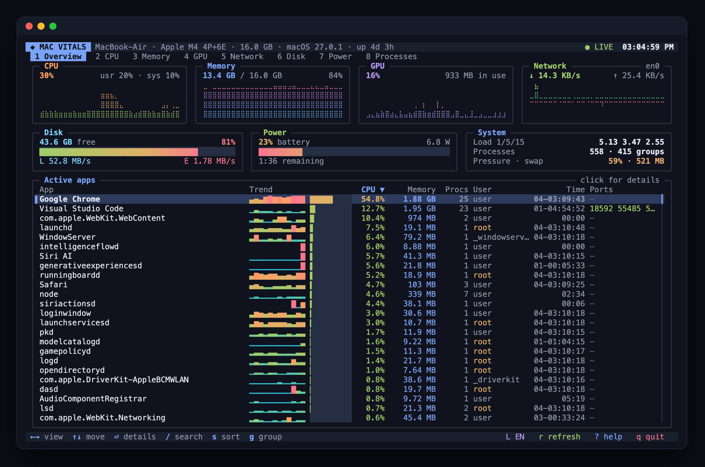
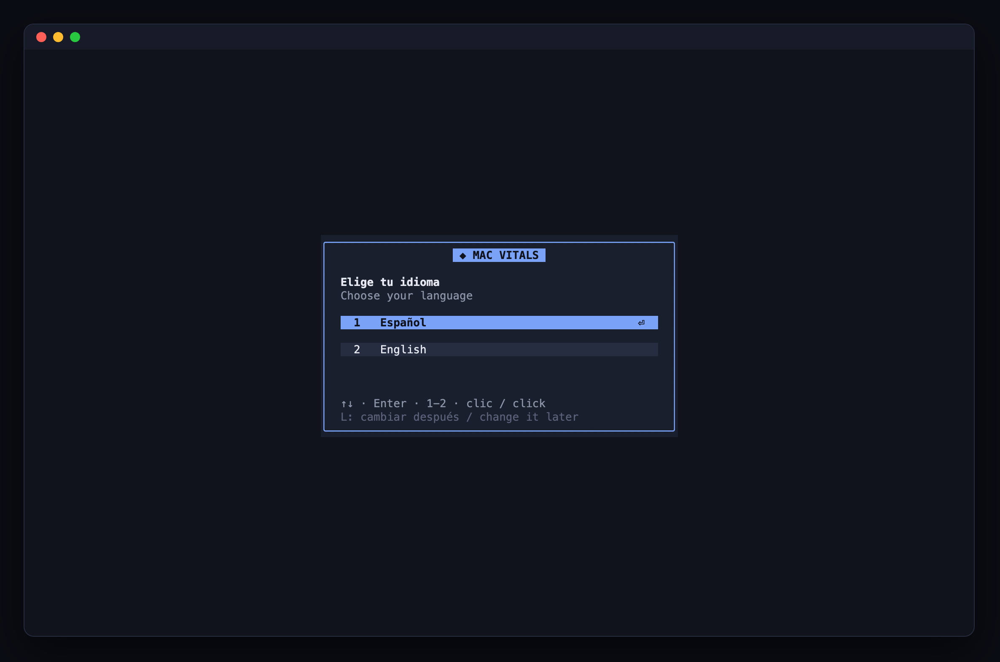
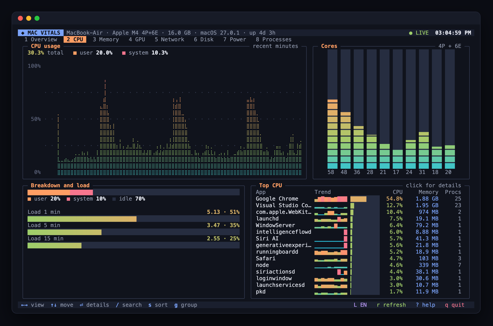
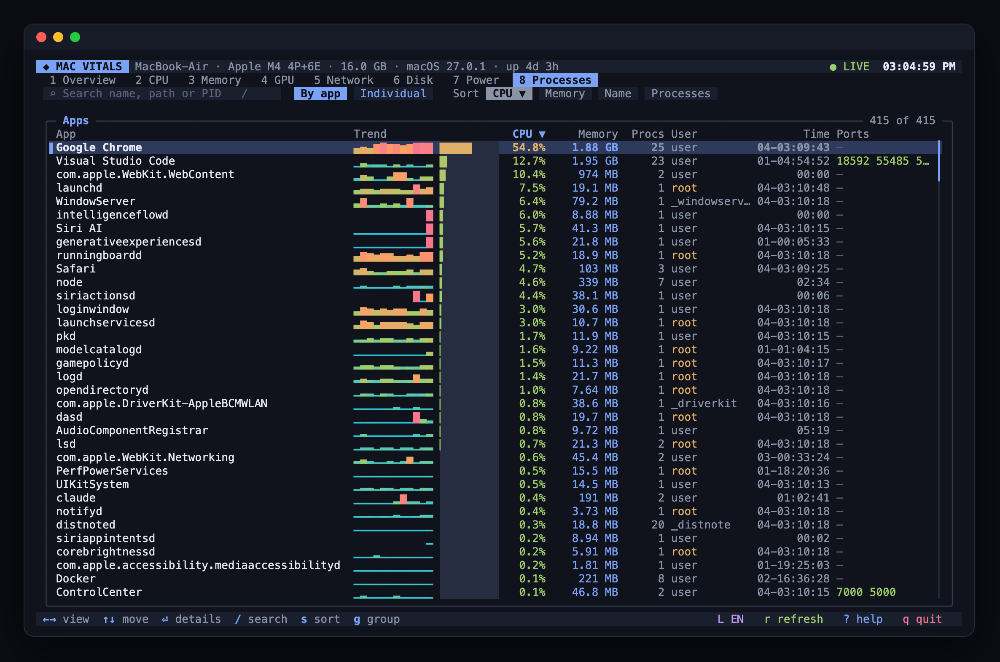
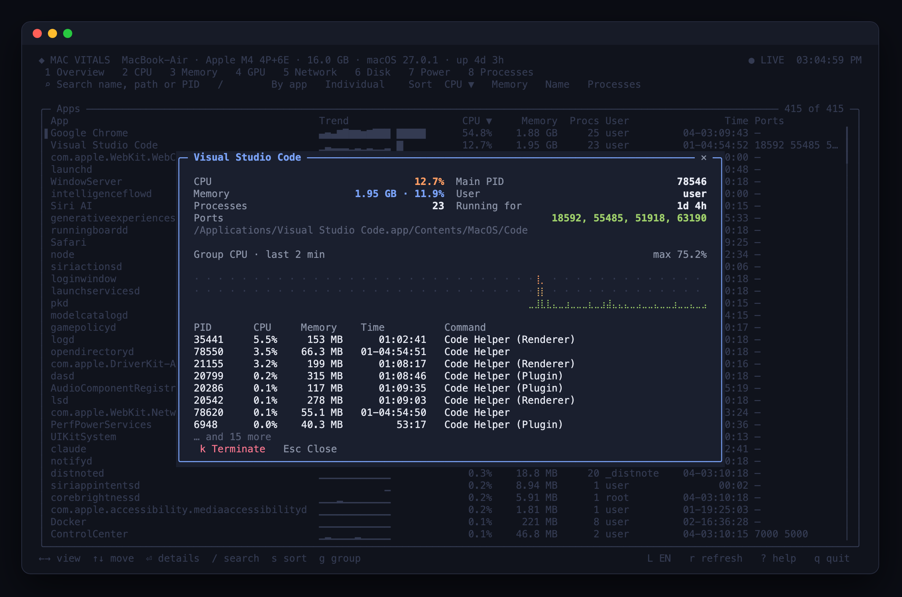

# Mac Vitals

[Español](README.md) · **English**

An interactive terminal dashboard that shows what your Mac is doing in real time: live charts for CPU, memory, GPU, network, disk and power, plus a process table you can drive with the keyboard and mouse. No dependencies, small footprint.



## Requirements

- macOS (tested on Apple Silicon)
- Node.js 20+
- pnpm 9+
- A terminal with mouse support (iTerm2, Ghostty, WezTerm, VS Code terminal or Terminal.app)

## Installation

```bash
git clone https://github.com/uligeo/vitals_mac.git
cd vitals_mac
pnpm install
pnpm start
```

### As a global command

```bash
pnpm setup             # first time only: sets PNPM_HOME in your shell
pnpm link --global     # adds the `vitals` command to your PATH
vitals                 # run it from any folder
pnpm unlink --global   # to remove it
```

## Language

On first launch you pick a language (Spanish or English), with your system language preselected. The choice is saved to `~/.config/mac-vitals/config.json`.



- Press `L` inside the app to switch language; the change is saved.
- `vitals --lang en` or `vitals --lang es` forces a language for that session only.

To add a language, add its dictionary to `src/i18n.js`.

## Views

| # | View | Contents |
|---|------|----------|
| 1 | Overview | Chart cards for CPU, memory, GPU and network; disk, battery and system; active apps |
| 2 | CPU | Usage history, per-core bars, user/system breakdown and load average |
| 3 | Memory | History, pressure, swap and the Apps / Wired / Compressed / Cached / Free breakdown |
| 4 | GPU | Device, renderer and tiler utilization, unified memory in use |
| 5 | Network | Mirrored download/upload chart, totals and listening TCP ports |
| 6 | Disk | Mirrored read/write chart, volume usage |
| 7 | Power | Battery level, status, cycles, maximum capacity and power draw |
| 8 | Processes | Filterable, sortable table with CPU trend, grouped by app or individual |

### Screenshots

| CPU | Processes |
|-----|-----------|
|  |  |



## Controls

Mouse:

- Click a tab, card or highlighted panel to open that view
- Click a row to see process details
- Click a column header to sort
- Scroll wheel moves through lists

Keyboard:

- `←` / `→`, `Tab` or `1`-`8`: switch view
- `↑` / `↓`, `j`, `PgUp` / `PgDn`, `Home` / `End`: move the selection
- `Enter`: open details · `Esc`: close
- `/`: search by name, path or PID
- `s`: change sort order · `g`: group by app or individual
- `k`: terminate the selected app (asks for confirmation)
- `p` or `Space`: pause sampling · `r`: refresh now
- `L`: change language · `?`: help · `q`: quit

## Footprint

The app stays around 80 MB RSS and 3 % CPU (measured on an M4 with 450 running processes and the mouse moving). How:

- The screen buffer uses typed arrays reused across renders.
- Only changed rows are redrawn, and mouse movement only triggers a render when the pointer reaches a different element.
- The gradient color palette is finite and memoized.
- V8 starts with a small young generation (`--max-semi-space-size=1`) and a 64 MB cap.
- Expensive probes (`lsof`, `df`, `pmset`) run every 10 to 30 s.

## Data sources

Everything comes from standard macOS tools, without elevated permissions: `ps`, `vm_stat`, `sysctl`, `ioreg` (GPU, disk and battery), `netstat`, `df`, `pmset` and `lsof`. Per-core CPU is computed from `os.cpus()` counters.

Terminating an app sends `SIGTERM` to the group's root process, only after confirmation.

## Checks

```bash
pnpm check
```

## License

[MIT](LICENSE)
