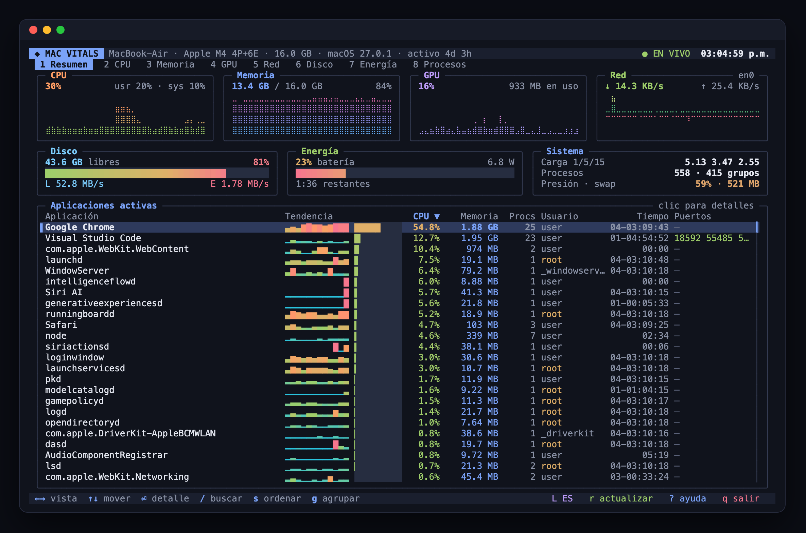
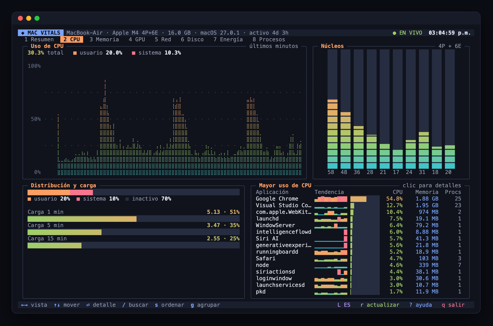
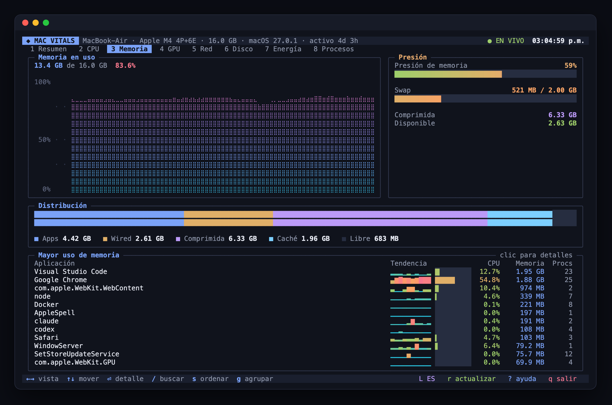
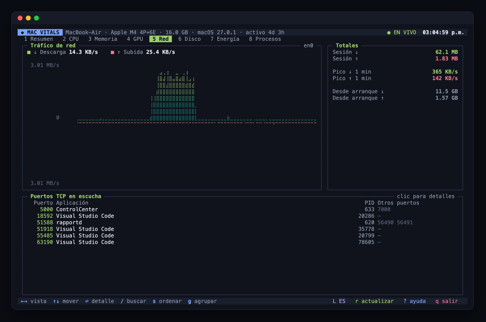
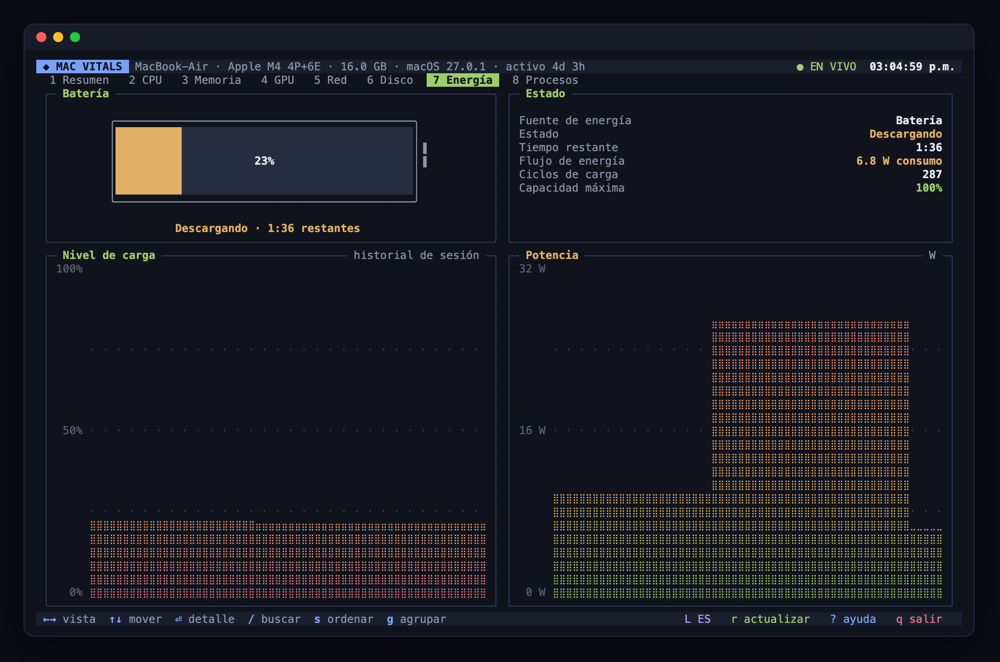
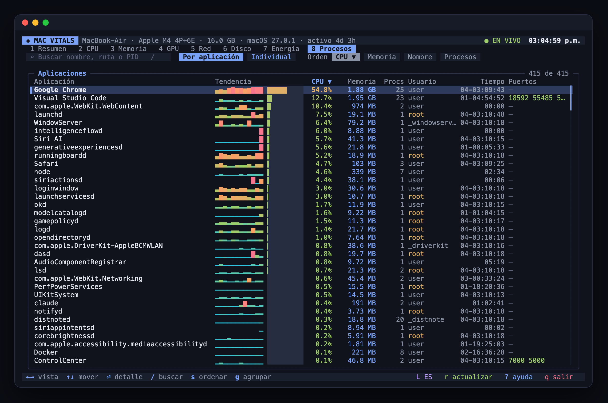
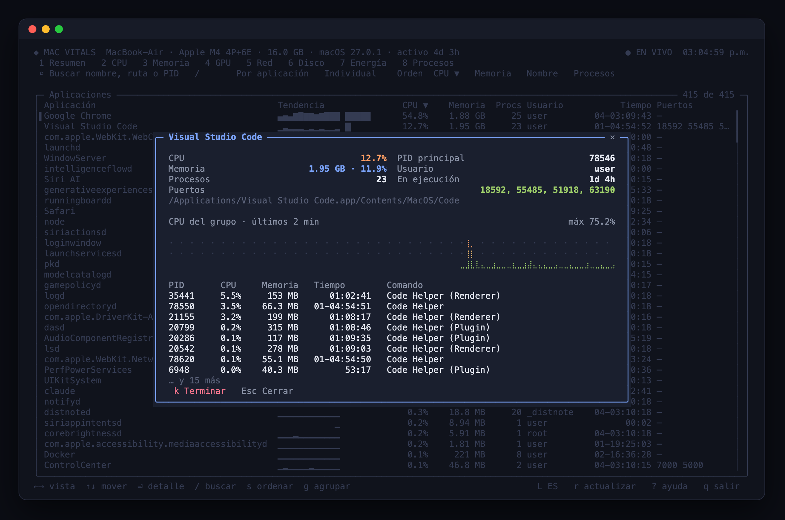

# Mac Vitals

**Español** · [English](README.en.md)

Panel interactivo en la terminal para observar la actividad de tu Mac en tiempo real: gráficas en vivo de CPU, memoria, GPU, red, disco y energía, más una tabla de procesos navegable con teclado y ratón. Escrito en TypeScript, sin dependencias en tiempo de ejecución y con bajo consumo.



## Requisitos

- macOS (probado en Apple Silicon)
- Node.js 20+
- pnpm 9+
- Una terminal con soporte de ratón (iTerm2, Ghostty, WezTerm, Terminal de VS Code o Terminal.app)

## Instalación

```bash
git clone https://github.com/uligeo/vitals_mac.git
cd vitals_mac
pnpm install   # instala y compila a dist/
pnpm start
```

### Como comando global

```bash
pnpm setup             # solo la primera vez: configura PNPM_HOME en tu shell
pnpm link --global     # registra el comando `vitals` en el PATH
vitals                 # se abre desde cualquier carpeta
pnpm unlink --global   # para quitarlo
```

## Idioma

La primera vez que abres la app eliges el idioma (español o inglés); la opción del sistema viene preseleccionada. La elección se guarda en `~/.config/mac-vitals/config.json`.


- `L` dentro de la app cambia de idioma y lo guarda.
- `vitals --lang en` o `vitals --lang es` fuerza un idioma solo para esa sesión.

Para agregar otro idioma basta con añadir su diccionario en `src/i18n.ts`.

## Vistas

| # | Vista | Contenido |
|---|-------|-----------|
| 1 | Resumen | Tarjetas con gráficas de CPU, memoria, GPU y red; disco, batería y sistema; aplicaciones activas |
| 2 | CPU | Historial de uso, barras por núcleo, distribución usuario/sistema y carga promedio |
| 3 | Memoria | Historial, presión, swap y desglose Apps / Wired / Comprimida / Caché / Libre |
| 4 | GPU | Uso del dispositivo, renderizado y teselado, memoria unificada en uso |
| 5 | Red | Gráfica espejo de descarga y subida, totales y puertos TCP en escucha |
| 6 | Disco | Gráfica espejo de lectura y escritura, uso de volúmenes |
| 7 | Energía | Nivel de batería, estado, ciclos, capacidad máxima y potencia |
| 8 | Procesos | Tabla filtrable y ordenable con tendencia de CPU, agrupada por aplicación o individual |

### Capturas

| CPU | Memoria |
|-----|---------|
|  |  |
| **Red** | **Energía** |
|  |  |
| **Procesos** | **Detalle de una aplicación** |
|  |  |

## Controles

Ratón:

- Clic en una pestaña, tarjeta o panel resaltado para abrir esa vista
- Clic en una fila para ver el detalle del proceso
- Clic en el encabezado de una columna para ordenar
- Rueda para desplazar listas

Teclado:

- `←` / `→`, `Tab` o `1`-`8`: cambiar de vista
- `↑` / `↓`, `j`, `RePág` / `AvPág`, `Inicio` / `Fin`: mover la selección
- `Enter`: abrir el detalle · `Esc`: cerrar
- `/`: buscar por nombre, ruta o PID
- `s`: cambiar el orden · `g`: agrupar por aplicación o individual
- `k`: terminar la aplicación seleccionada (pide confirmación)
- `p` o `Espacio`: pausar el muestreo · `r`: actualizar ahora
- `L`: cambiar idioma · `?`: ayuda · `q`: salir

## Consumo

La app se mantiene alrededor de 80 MB de RSS y 3 % de CPU (medido en un M4 con 450 procesos activos y el ratón en movimiento). Para lograrlo:

- El búfer de pantalla usa arreglos tipados que se reutilizan entre renders.
- Solo se redibujan las filas que cambian, y el movimiento del ratón solo provoca un render al pasar a otro elemento.
- La paleta de colores de los degradados es finita y se memoriza.
- V8 arranca con un heap joven pequeño (`--max-semi-space-size=1`) y un tope de 64 MB.
- Las sondas costosas (`lsof`, `df`, `pmset`) se ejecutan cada 10 a 30 s.

## Fuentes de datos

Todo se obtiene sin permisos elevados con herramientas estándar de macOS: `ps`, `vm_stat`, `sysctl`, `ioreg` (GPU, disco y batería), `netstat`, `df`, `pmset` y `lsof`. La CPU por núcleo se calcula con los contadores de `os.cpus()`.

Terminar una aplicación envía `SIGTERM` al proceso raíz del grupo, solo después de confirmar.

## Desarrollo

El código fuente está en `src/` (TypeScript en modo `strict`) y se compila a `dist/` con `tsc`. Se ejecuta el JavaScript compilado, así que TypeScript no añade consumo en tiempo de ejecución.

```bash
pnpm build   # compila a dist/
pnpm dev     # recompila al guardar; en otra terminal: pnpm start
pnpm check   # verificación de tipos
```

```
src/
  index.ts      ciclo de vida, entrada de teclado y ratón
  types.ts      tipos compartidos (datos, estado, acciones)
  sampler.ts    muestreo periódico, tasas e historial
  probes.ts     comandos de macOS y su análisis
  term.ts       búfer de pantalla, regiones clicables y salida ANSI
  charts.ts     gráficas braille, medidores y barras
  widgets.ts    paneles, botones, tablas y modales
  chrome.ts     encabezado, pestañas, pie, modales y selector de idioma
  i18n.ts       traducciones
  config.ts     preferencias guardadas y argumentos
  views/        una vista por pestaña
```

## Licencia

[MIT](LICENSE)
